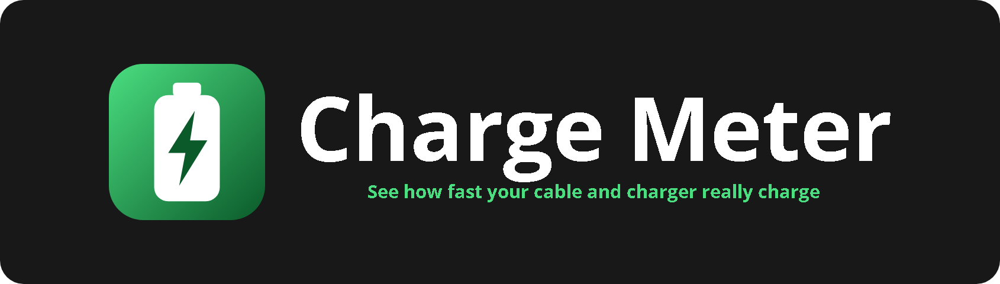

<p align="center"></p>

<p align="center">    </p>

A Flutter app that shows how fast and how strongly a cable or charger is charging your phone.

## Features

- **Live view**: current (mA), voltage (V), power (W = V x A), temperature, health, level and plug type (AC / USB / Wireless / Dock), plus a large gauge and a strength rating:
  - Slow: under 7.5 W
  - Normal: 7.5 to 15 W
  - Fast: 15 to 25 W
  - Super fast: 25 W and up
- **Rolling live chart** (fl_chart) of the last 2 minutes, switchable between W, mA and V.
- **Test this cable**: name a cable or charger, run a 30, 45 or 60 s test (the first 3 s are skipped while the charger negotiates), and the averaged result is saved locally with shared_preferences.
- **Leaderboard**: ranks saved cables by average watts. Swipe a row to delete it.
- Material 3, follows the system light/dark theme.

## How it reads the data

### Android (main target)
`android/app/src/main/kotlin/com/example/charge_meter/BatteryReader.kt` is exposed over the `charge_meter/battery` MethodChannel and polled once per second:

- `BatteryManager.BATTERY_PROPERTY_CURRENT_NOW` gives the instantaneous current. The spec says microamps with positive meaning charging, but vendors differ, so the reader normalises it:
  - **Unit**: if the magnitude is 20,000 or more it is treated as µA (and that choice sticks for the rest of the session). Otherwise it is treated as mA.
  - **Sign**: if the phone is plugged in and charging but the value is negative, the sign is flipped. If the phone is unplugged and the value is positive, it is flipped too. The result is always "positive = into the battery".
- The sticky `ACTION_BATTERY_CHANGED` intent supplies voltage (mV; a value under 100 is read as V and one over 100,000 as µV), temperature (tenths of °C), plug type, health, status and level.
- The raw value and the unit decision appear at the bottom of the Live screen so you can check the heuristic on your device.

### iOS (fallback)
iOS gives apps **no access to charging current or voltage**. On iOS the app uses `battery_plus` (level and charging state) and estimates **% per minute** from how the level changes over time. The UI shows "Estimate mode" and explains this. iOS only reports whole percents, so tests are offered as 1, 3 or 5 minutes and the estimate takes a few minutes to settle.

## Run it

```bash
cd charge_meter
flutter pub get
flutter run            # with an Android phone connected (USB debugging on)
flutter build apk      # release APK in build/app/outputs/flutter-apk/
flutter test
```

iOS: open on a Mac, then run `flutter run` with an iPhone connected (CocoaPods required).

> **Windows note:** if the project lives in a very deep folder, `flutter` can crash with
> `PathNotFoundException ... FlutterGeneratedPluginSwiftPackage` because the path goes over 260 characters.
> Move the project to a shorter path (for example `C:\dev\charge_meter`) or enable Windows long paths.

## Tips for fair comparisons

- Test each cable at a similar battery level (20 to 70% is best). Phones throttle charging near full and when hot.
- Keep the screen on and the phone idle. The current shown is what goes *into the battery*, so heavy use lowers it.
- Results are approximate. Fuel-gauge readings vary between devices, and some phones update `CURRENT_NOW` only every few seconds.

## Project layout

```
lib/
  main.dart                     app shell, M3 theme, navigation
  services/battery_monitor.dart polling, history, iOS %/min estimate
  services/battery_sample.dart  sample model, watts = V x A
  services/rating.dart          slow / normal / fast / super fast
  services/results_store.dart   leaderboard persistence (shared_preferences)
  screens/                      live, test, leaderboard
  widgets/                      gauge, live chart, tiles
android/app/src/main/kotlin/com/example/charge_meter/
  MainActivity.kt               MethodChannel registration
  BatteryReader.kt              BatteryManager + ACTION_BATTERY_CHANGED reader
```

## License

Released under the [MIT License](LICENSE).
